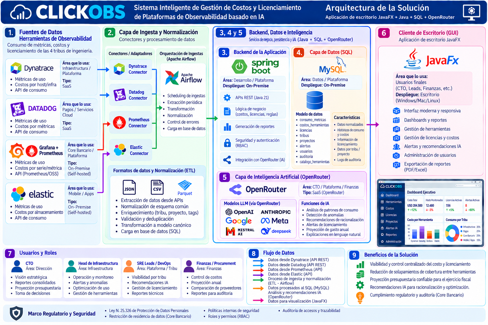

# CLICKOBS

**Sistema Inteligente de Gestión de Costos y Licenciamiento de Plataformas de Observabilidad basado en IA**

Proyecto del *Seminario de Práctica de Informática* (Universidad Siglo 21). CLICKOBS es un sistema para una fintech ficticia (CLICKOBS S.A., LATAM, ~280 empleados) que centraliza el consumo y el costo de cuatro herramientas de observabilidad (Dynatrace, Datadog, Grafana/Prometheus y Elastic), detecta solapamientos de cobertura y genera recomendaciones y alertas de licenciamiento con IA (vía OpenRouter).

- **Autor:** Jorge Correa Alvarez (legajo VINF02919)
- **Docentes:** Pablo Virgolini y Juan Ojeda
- **Metodología:** Proceso Unificado de Desarrollo (PUD)



*La infografía es una vista conceptual. El modelo relacional vigente es el de `db/` y el DER de `docs/img/der_clickobs.png`.*

## Arquitectura

| Capa | Tecnología |
|---|---|
| Cliente de escritorio | JavaFX (Windows, macOS, Linux) |
| Backend (arquitectura objetivo) | Java 21 + Spring Boot (API REST) |
| Base de datos | MySQL 8 |
| Ingesta y normalización | Conectores por herramienta + Apache Airflow |
| IA | OpenRouter (gateway hacia modelos de lenguaje) |

**Alcance del prototipo actual:** cliente JavaFX conectado por JDBC directo a MySQL (subconjunto de la arquitectura objetivo). El backend, la orquestación con Airflow y las integraciones reales con las APIs se incorporan en la fase de Construcción.

## Estructura del repositorio

```
clickobs/
├── pom.xml         Proyecto Maven (Java 21, JavaFX, MySQL Connector/J)
├── src/            Código fuente del prototipo JavaFX
├── pruebas/        Casos de prueba ejecutables (77)
├── db/             Scripts SQL (MySQL)
├── airflow/        Ingesta con Apache Airflow (DAG, adaptadores, pruebas)
├── docs/           Documento de la entrega (Word y PDF)
│   ├── img/        Diagramas, infografías, mockups y capturas de evidencia
│   └── guias/      Guías paso a paso (entorno MySQL y carga de tablas)
└── README.md
```

## Prototipo JavaFX (TP3)

Pantallas (según los mockups de `docs/img/mockup_*.png`): inicio de sesión (CU-01), Dashboard (extra), Consumo, Comparar costos (CU-02, ordenar/ubicar/exportar CSV), Recomendaciones IA (CU-03, IA simulada), Alertas (CU-04, umbrales + cola de pendientes) y Administración (conectores). Acceso por rol.

Conceptos aplicados: encapsulamiento, herencia, polimorfismo y abstracción (`Herramienta` y subclases, `ClienteIA`); pila y cola enlazadas, ordenamiento por selección y búsqueda binaria hechos a mano (`util/`); excepciones propias y validación de ingreso numérico (`excepcion/`, `util/Validador`). Pruebas en `pruebas/`.

### Cumplimiento de la consigna del TP3

| Requisito | Dónde está en el código |
|---|---|
| Abstracción | `model/Herramienta` (clase abstracta con `calcularCostoPeriodo`, `getTipo`, `describirCosto`) e interfaz `service/ClienteIA` |
| Herencia | `HerramientaSaaS` y `HerramientaSelfHosted` extienden `Herramienta`; jerarquía de excepciones en `excepcion/` |
| Polimorfismo | `calcularCostoPeriodo()` se comporta distinto en cada subclase (SaaS suma consumo; self-hosted aplica el mínimo del cluster); `IASimulada` implementa `ClienteIA` |
| Encapsulamiento | Atributos privados y setters que validan: `UmbralAlerta.setMontoMaximo`, `Conector.setEstado` |
| Constructores | Con validación (`UmbralAlerta`, `Conector`, `HerramientaSaaS`) y uno sobrecargado; `super(...)` en las subclases |
| Declaración y creación de objetos | Capa `dao/` y `service/`; los objetos del dominio se crean desde los resultados de la base |
| Estructuras condicionales y repetitivas | `if`/`switch`/`for`/`while` en `service/`, `util/` y `ui/` |
| Menú de selección | `ui/PrincipalView` (barra de menú y menú lateral por rol, `model/Permisos`) |
| Excepciones | `util/Validador.monto` captura `NumberFormatException` y lanza `MontoInvalidoException`; `PeriodoInvalidoException`; `SQLException` tratada en `ui/Async` |
| Estructuras de datos | `util/PilaEnlazada` (historial de navegación, «Volver») y `util/ColaEnlazada` (alertas pendientes) |
| Ordenación y búsqueda | `util/Algoritmos`: ordenamiento por selección y búsqueda binaria, hechos a mano (Comparar costos y Alertas) |
| Compila y se ejecuta | `mvn javafx:run`; 77 pruebas en `pruebas/` (verificadas sobre MySQL 8.0: 77 OK, 0 FALLO) |

Requisitos: JDK 21, Maven y la base cargada con los scripts de `db/` (`Endurecimiento_CLICKOBS.sql` es opcional: agrega UNIQUE/CHECK/NOT NULL). Paso a paso: [`docs/guias/Ejecutar_CLICKOBS.md`](docs/guias/Ejecutar_CLICKOBS.md).

```bash
cp src/main/resources/db.properties.example db.properties   # completar usuario y clave (db.properties está en .gitignore)
mvn javafx:run
```

Usuarios de prueba: `dfarias` (CTO), `sre.infra` (SRE Lead), `devops.pagos` (DevOps), `finanzas` (Finanzas). El login valida que el usuario exista; la contraseña se verificará más adelante.

## Ingesta de datos (Airflow)

Ver [`airflow/README.md`](airflow/README.md). Airflow escribe en `consumo`; la aplicación solo lee.

## Base de datos

Modelo de 9 tablas: `tribu`, `rol_permiso`, `usuario`, `servicio`, `herramienta`, `conector`, `consumo`, `umbral_alerta` y `recomendacion_ia`. Consumo y Costo se unificaron en la tabla `consumo` (campo `monto_usd`) para evitar un JOIN redundante en la consulta comparativa.

Ejecutar en este orden, sobre un schema vacío llamado `clickobs`:

| # | Script | Función |
|---|---|---|
| 1 | `db/CreacionTablas_CLICKOBS.sql` | Crea las 9 tablas |
| 2 | `db/Insert_CLICKOBS.sql` | Carga datos de prueba |
| 3 | `db/Consulta_CLICKOBS.sql` | CU-02: comparar costos entre herramientas |
| 4 | `db/Borrado_CLICKOBS.sql` | Vacía las tablas y verifica (ejecutar al final) |

```sql
CREATE DATABASE IF NOT EXISTS clickobs;
USE clickobs;
```

Los datos de prueba no llevan tildes a propósito, para evitar problemas de codificación entre el cliente y el servidor MySQL.

## Documentación

- Documento completo (TP1 + TP2 + TP3): [`docs/CORREA-JORGE-AP3.pdf`](docs/CORREA-JORGE-AP3.pdf) (versión editable: `.docx`)
- Guías: [`docs/guias/`](docs/guias/)

## Estado

| Fase del PUD | Estado |
|---|---|
| Inicio | Completa |
| Elaboración | Modelo de datos, scripts SQL, diagramas y mockups completos. Prototipo JavaFX en desarrollo |
| Construcción | Pendiente |
| Transición | Pendiente |

## TP4: versión final integradora

| Requisito de la consigna | Dónde está |
|---|---|
| Patrón de diseño: MVC (vistas `ui/`, controladores `controller/`, modelo) + DAO con Template Method | `controller/*Controller.java`, `dao/Dao.java`, `dao/DaoBase.java`, `dao/*Dao.java`; informe secciones 23.5 y 23.5.1 |
| Persistencia y consultas en MySQL, resultados en la UI | `db/Db.java`, `dao/*`, `ui/*View.java`; sección 23.6 |
| Excepciones con MySQL | `excepcion/PersistenciaException.java`; sección 23.7 |
| Clases abstractas e interfaces | `Herramienta`, `DaoBase`, `Dao<T>`, `ClienteIA`; sección 23.8 |
| Arreglos y ArrayList | `model/ResumenAnual.java`, `ConsumoDao.costosPorMes`, `topServicios`; sección 23.9 |
| Archivos | `service/Bitacora.java`, exportación CSV, `db.properties`; sección 23.10 |
| Pruebas | `pruebas/PruebasClickobs.java` (127 casos) |
| Informe | `docs/CORREA-JORGE-AP4.pdf` |

Datos opcionales para el gráfico mensual: `db/Historico_demo_CLICKOBS.sql` (se quitan con `DELETE FROM consumo WHERE id_consumo > 5;`).

**Video de presentación (3 min):** https://www.youtube.com/watch?v=bGuImoquN2g

